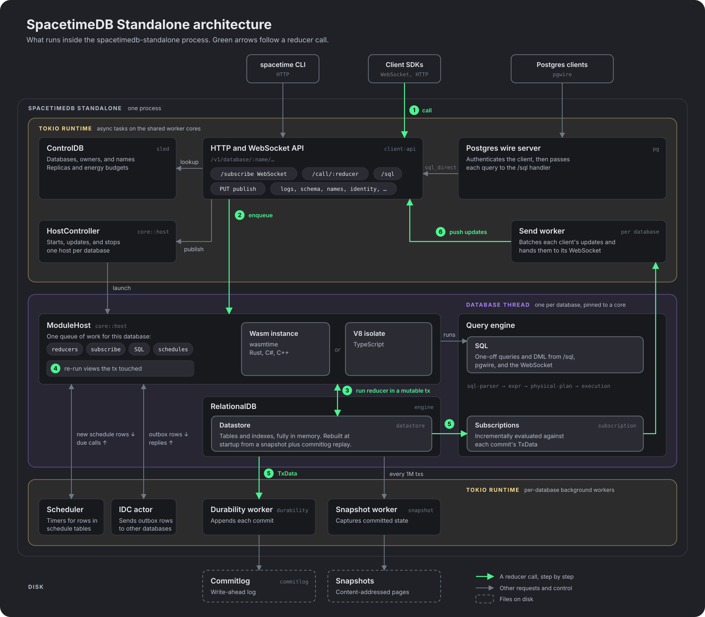

# DEVELOP.md

This document explains how to configure the environment, run the LLM benchmark tool, and work with the benchmark suite. It ends with an overview of the SpacetimeDB Standalone architecture.

---

## Table of Contents

1. [Prerequisites](#prerequisites)
2. [Quick Checks & Fixes](#quick-checks-fixes)
3. [Environment Variables](#environment-variables)
4. [Benchmark Suite](#benchmark-suite)
5. [Context Construction](#context-construction)
6. [Troubleshooting](#troubleshooting)
7. [Architecture](#architecture)
---

## Prerequisites

- **Run from repo root** — `cargo llm` and related commands must be run from the workspace root (this repo).
- **TypeScript benchmarks** — Run `pnpm build` in `crates/bindings-typescript` first. Rust and C# use local crates that are built as part of the workspace.
- **Windows (nvm4w)** — If `pnpm` is not found when running TypeScript benchmarks, set `NODEJS_DIR` to your Node.js bin directory (e.g. `C:\nvm\v20.10.0`).

---

## Quick Checks & Fixes

Use this single command to quickly unblock CI by regenerating hashes and running only GPT-5 for the minimal Rust + C# passes. This is not the full benchmark suite.

**Note: You will need OpenAI API keys to run this locally**. Alternatively, any SpacetimeDB member can comment `/update-llm-benchmark` on a PR to start a CI job to do this.

`cargo llm ci-quickfix`
What this does:
1. Runs Rust rustdoc_json pass for GPT-5 only.
2. Runs C# docs pass for GPT-5 only.
3. Writes updated results & summary.

---

> Model IDs passed to `--models` must match configured routes (see `model_routes.rs`), e.g. `"openai:gpt-5"`.


### Spacetime CLI
Publishing is performed via the `spacetime` CLI (`spacetime publish -c -y --server <name> <db>`). Ensure:
- `spacetime` is on PATH
- The target server is reachable/running

## Environment Variables

> These are the **defaults** and/or recommended dev values.

| Name | Purpose | Values / Example | Required |
|---|---|---|---|
| `SPACETIME_SERVER` | Target SpacetimeDB environment | `local` | ✅ |
| `LLM_DEBUG` | Print short debug info while generating | `true` / `false` (default `true` in dev) | ✅ |
| `LLM_DEBUG_VERBOSE` | Extra‑verbose logs (payloads, scoring detail) | `false` | ✅ |
| `LLM_BENCH_CONCURRENCY` | Parallel task concurrency across the whole bench run | `20` | ✅ |
| `LLM_BENCH_ROUTE_CONCURRENCY` | Per‑route concurrency (throttle per vendor/model) | `4` | ✅ |
| `OPENAI_API_KEY` | OpenAI credential | `sk-...` | optional* |
| `OPENAI_BASE_URL` | OpenAI-compatible base URL override | `https://api.openai.com/` | optional |
| `ANTHROPIC_API_KEY` | Anthropic credential | `...` | optional* |
| `ANTHROPIC_BASE_URL` | Anthropic base URL override | `https://api.anthropic.com` | optional |
| `GOOGLE_API_KEY` | Gemini credential | `...` | optional* |
| `GOOGLE_BASE_URL` | Gemini base URL override | `https://generativelanguage.googleapis.com` | optional |
| `XAI_API_KEY` | xAI Grok credential | `...` | optional |
| `DEEPSEEK_API_KEY` | DeepSeek credential | `...` | optional |
| `META_API_KEY` | Meta Llama credential  | `...` | optional* |

\*Required only if you plan to run that provider locally.

**Canonical dev block** (copy/paste into your shell profile):

```bash
OPENAI_API_KEY=
OPENAI_BASE_URL=https://api.openai.com/

ANTHROPIC_API_KEY=
ANTHROPIC_BASE_URL=https://api.anthropic.com

GOOGLE_API_KEY=
GOOGLE_BASE_URL=https://generativelanguage.googleapis.com

XAI_API_KEY=
XAI_BASE_URL=https://api.x.ai

DEEPSEEK_API_KEY=
DEEPSEEK_BASE_URL=https://api.deepseek.com

META_API_KEY=
META_BASE_URL=https://openrouter.ai/api/v1

SPACETIME_SERVER="local"
LLM_DEBUG=true
LLM_DEBUG_VERBOSE=false
LLM_BENCH_CONCURRENCY=20
LLM_BENCH_ROUTE_CONCURRENCY=4
```

Windows PowerShell:

```powershell
$env:SPACETIME_SERVER="local"
$env:LLM_DEBUG="true"
$env:LLM_DEBUG_VERBOSE="false"
$env:LLM_BENCH_CONCURRENCY="20"
$env:LLM_BENCH_ROUTE_CONCURRENCY="4"
```


### LLM Providers — Keys & Base URLs

> Notes
> - These match the providers wired in this repo (`OpenAiClient`, `AnthropicClient`, `GoogleGeminiClient`, `XaiGrokClient`, `DeepSeekClient`, `MetaLlamaClient`).

| Provider      | API Key Env         | Base URL Env (optional) | Default Base URL |
|---------------|---------------------|-------------------------|---|
| OpenAI        | `OPENAI_API_KEY`    | `OPENAI_BASE_URL`       | `https://api.openai.com` |
| Anthropic     | `ANTHROPIC_API_KEY` | `ANTHROPIC_BASE_URL`    | `https://api.anthropic.com` |
| Google Gemini | `GOOGLE_API_KEY`    | `GOOGLE_BASE_URL`       | `https://generativelanguage.googleapis.com` |
| xAI Grok      | `XAI_API_KEY`       | `XAI_BASE_URL`          | `https://api.x.ai` |
| DeepSeek      | `DEEPSEEK_API_KEY`  | `DEEPSEEK_BASE_URL`     | `https://api.deepseek.com` |
| META          | `META_API_KEY`      | `META_BASE_URL`         | `https://openrouter.ai/api/v1` |

---

## Benchmark Suite

Results directory: `docs/llms`

### Results Storage

Benchmark results are stored in a remote PostgreSQL database via the spacetime-web API. Results are uploaded automatically after each benchmark batch when `LLM_BENCHMARK_UPLOAD_URL` and `LLM_BENCHMARK_API_KEY` environment variables are set. Use `--dry-run` to skip uploading.
### Current Benchmarks

**basics**
000. empty-reducers — tests whether it can create basic reducers with various arguments
001. basic-tables — can it create tables with basic columns
002. scheduled-table — can it create a scheduled table and reducer
003. struct-in-table — can it put a struct in a table
004. insert — can it insert a row
005. update — can it update a row
006. delete — can it delete a row
007. crud — can it insert, update, and delete a row in the same reducer
008. index-lookup — can it look up something from an index
009. init — can it write the init reducer
010. connect — can it write the client_connected/client_disconnected reducers
011. helper-function — can it create a non-reducer helper function

**schema**
012. spacetime-product-type — can it define a new spacetime product type
013. spacetime-sum-type — can it define a new sum type
014. elementary-columns — can it create columns with basic types
015. product-type-columns — can it create columns with product types
016. sum-type-columns — can it create columns with sum types
017. scheduled — can it create scheduled columns
018. constraints — can it add primary keys, unique constraints, and indexes
019. many-to-many — can it create a many-to-many relationship
020. ecs — can it create a basic ecs
021. multi-column-index — can it create a multi-column index

Benchmarks live under `benchmarks/` with structure like:

```
benchmarks/
  category/
    t_001_foo/
      tasks/
        rust.txt
        csharp.txt
      answers/
        rust.rs
        csharp.cs
      spec.rs          # scoring config, reducer/schema checks, etc.
```

### Creating a new benchmark

1. **Copy existing benchmark**
- Duplicate any existing benchmark folder.
- Bump the numeric prefix to a new, unused ID: `t_123_my_task`.

2. **Rename for the new task**
- Rename the folder to your ID + short slug: `t_123_my_task`.

3. **Write the task prompt**
- Create/update `tasks/rust.txt` and/or `tasks/csharp.txt`.
- Be explicit (tables, reducers, helpers, constraints). Avoid ambiguity.

4. **Add golden answers**
- Implement the canonical solution in `answers/rust.rs` and/or `answers/csharp.cs`.

5. **Define scoring**
- Edit `spec.rs` to add scorers (e.g., schema/table/field checks, reducer/func exists).

6. **Quick validation**
- Build goldens only:  
  `cargo llm run --goldens-only --tasks t_123_my_task`

7. **Categorize**
- Ensure the folder sits under the right category path.


### Typical Commands

```bash
# Run everything with current env (providers/models from your .env)
cargo llm run

# Only Rust (or C#)
cargo llm run --lang rust
cargo llm run --lang csharp

# Only certain categories (use your actual category names)
cargo llm run --categories basics,schema

# Only certain tasks by number (globally numbered)
cargo llm run --tasks 0,7,12

# Limit providers/models explicitly
cargo llm run \
  --providers openai,anthropic \
  --models "openai:gpt-5 anthropic:claude-sonnet-4-5"

# Dry runs
cargo llm run --hash-only         # build context only (no provider calls)
cargo llm run --goldens-only      # build/check goldens only

# Be aggressive (skip some safety checks)
cargo llm run --force

# CI sanity check per language
cargo llm ci-check --lang rust
cargo llm ci-check --lang csharp

# Generate PR comment markdown (compares against master baseline)
cargo llm ci-comment
# With custom baseline ref
cargo llm ci-comment --baseline-ref origin/main
```

Outputs:
- Logs to stdout/stderr (respecting `LLM_DEBUG`/`LLM_DEBUG_VERBOSE`).
- JSON results in a per‑run folder (timestamped), merged into aggregate reports.

---

## Context Construction

The benchmark tool constructs a context (documentation) that is sent to the LLM along with each task prompt. The context varies by language and mode.

### Modes

| Mode | Language | Source | Description |
|------|----------|--------|-------------|
| `rustdoc_json` | Rust | `crates/bindings` | Generates rustdoc JSON and extracts documentation from the spacetimedb crate |
| `docs` | C# | `docs/docs/**/*.md` | Concatenates all markdown files from the documentation |

### Tab Filtering

When building context for a specific language, the tool filters `<Tabs>` components to only include content relevant to the target language. This reduces noise and helps the LLM focus on the correct syntax.

**Filtered tab groupIds:**

| groupId | Purpose | Tab Values |
|---------|---------|------------|
| `server-language` | Server module code examples | `rust`, `csharp`, `typescript` |
| `client-language` | Client SDK code examples | `rust`, `csharp`, `typescript`, `cpp`, `blueprint` |

**Filtering behavior:**
- For C# tests: Only `value="csharp"` tabs are kept
- For Rust tests: Only `value="rust"` tabs are kept
- If no matching tab exists (e.g., `client-language` with only `cpp`/`blueprint`), the entire tabs block is removed

**Example transformation:**

Before (in markdown):
```html
<Tabs groupId="server-language" queryString>
<TabItem value="csharp" label="C#">
C# code here
</TabItem>
<TabItem value="rust" label="Rust">
Rust code here
</TabItem>
</Tabs>
```

After (for C# context):
```
C# code here
```

### Documentation Best Practices

When writing documentation that will be used by the benchmark:

1. **Use consistent tab groupIds**: Always use `server-language` for server module code and `client-language` for client SDK code
2. **Include all supported languages**: Ensure each `<Tabs>` block has tabs for all languages you want to test
3. **Use consistent naming conventions**: The benchmark compares LLM output against golden answers, so documentation should reflect the expected conventions (e.g., PascalCase table names for C#)

---

## Troubleshooting

**HTTP 400/404 from providers**
- Check the model ID spelling and whether it’s available for your account/region.
- Verify the correct base URL for non-default gateways.

**Timeouts / Rate-limits**
- Lower `LLM_BENCH_CONCURRENCY` or `LLM_BENCH_ROUTE_CONCURRENCY`.
- Some providers aggressively throttle bursts; use backoff/retry when supported.

---

## Architecture

This section maps what runs inside SpacetimeDB Standalone (`spacetimedb-standalone`) and how a request moves through it.

<p align="center">
    
</p>

### Where things run

At startup, SpacetimeDB splits the machine's cores into pools ([`startup.rs`](../crates/core/src/startup.rs)). The yellow areas in the diagram run on the shared Tokio worker cores: the HTTP, WebSocket and Postgres servers, ControlDB, the HostController, and each database's background workers.

The purple area runs on a thread of the database's own. Each database gets one thread, pinned to a core from the database pool ([`jobs.rs`](../crates/core/src/util/jobs.rs)). Several databases can share a core, and they are rebalanced as databases come and go. Reducers for a database therefore run one at a time, on one core.

### A reducer call, step by step

The numbers match the green arrows in the diagram.

1. A client calls a reducer, either with a call message on its WebSocket or with `POST /v1/database/:name/call/:reducer` ([`routes/database.rs`](../crates/client-api/src/routes/database.rs)). The API resolves the database name through ControlDB and finds the host for that database.
2. The call goes onto the database's [`ModuleHost`](../crates/core/src/host/module_host.rs) queue. Everything that touches the database goes through this queue: reducers, new subscriptions, SQL, and scheduled calls.
3. The ModuleHost runs the reducer in the module's Wasm instance ([`wasmtime`](../crates/core/src/host/wasmtime)) or V8 isolate ([`v8`](../crates/core/src/host/v8)), inside a mutable transaction on the in-memory [datastore](../crates/datastore).
4. Before committing, the host re-runs any views whose inputs the transaction touched and writes their results into the views' backing tables, all in the same transaction ([`module_host_actor.rs`](../crates/core/src/host/wasm_common/module_host_actor.rs)). If a view fails, the whole transaction rolls back.
5. The transaction commits and produces a `TxData` describing its inserts and deletes ([`commit_and_broadcast_event`](../crates/core/src/subscription/module_subscription_actor.rs)). The `TxData` goes to the durability worker, which appends it to the [commitlog](../crates/commitlog), and to subscription evaluation, which computes each subscribed query's changes from the `TxData` rather than re-running the query.
6. The send worker batches each client's updates and hands them to that client's WebSocket ([`module_subscription_manager.rs`](../crates/core/src/subscription/module_subscription_manager.rs)).

Procedures are the exception to the queue: they run on module instances borrowed from a separate pool, so a procedure waiting on the network does not hold up reducers.

### Other paths

- **Subscribing.** A subscribe message goes through the same queue, because the module may need to materialize views before the query can run. The subscription manager then sends the initial rows and keeps the query registered for step 5.
- **SQL.** `POST /v1/database/:name/sql` and the [Postgres wire server](../crates/pg/src/pg_server.rs) share one handler, `sql_direct`, which runs the statement on the database's thread through the ModuleHost ([`sql/execute.rs`](../crates/core/src/sql/execute.rs)). Queries go through the query engine crates, [`sql-parser`](../crates/sql-parser), [`expr`](../crates/expr), [`physical-plan`](../crates/physical-plan) and [`execution`](../crates/execution). DML statements commit and broadcast like a reducer does.
- **Publishing.** `PUT /v1/database/:name` (or `POST /v1/database` for an unnamed database) records the database in ControlDB and asks the [`HostController`](../crates/core/src/host/host_controller.rs) to start the module or hot-swap it.
- **Schedules.** Inserting a row into a schedule table registers a timer with the [scheduler](../crates/core/src/host/scheduler.rs). When the timer fires, the scheduler puts the scheduled reducer or procedure on the queue. On startup, the scheduler reloads every schedule table listed in `st_scheduled`.
- **Inter-database calls.** Rows inserted into an outbox table wake the [IDC actor](../crates/core/src/host/idc_actor.rs), which delivers them to the target database's `/call-from-database/:reducer` route and then runs the module's result callback.
- **Recovery.** When a database opens, [`RelationalDB`](../crates/engine/src/relational_db.rs) restores the latest [snapshot](../crates/snapshot) and replays the commitlog from that point. The [snapshot worker](../crates/engine/src/snapshot.rs) takes a new snapshot every 1,000,000 transactions.

### ControlDB

ControlDB holds the server's view of the world: which databases exist, who owns them, their names, their replicas, and energy budgets. It is a [sled](https://github.com/spacejam/sled) database ([`control_db.rs`](../crates/standalone/src/control_db.rs)).

### Updating the diagram

The diagram is a plain SVG at [`images/server-architecture.svg`](../images/server-architecture.svg), so you can edit it directly. Its colors and fonts come from the docs site theme in [`docs/src/css/custom.css`](src/css/custom.css).
